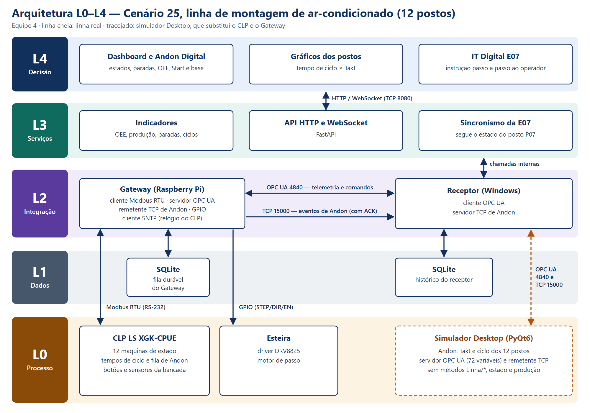

# Lean Manufacturing — Cenário 25: linha de montagem de ar-condicionado com 12 postos

**Equipe 4** · PGENE586 — Lean Manufacturing e Qualidade Aplicadas à Indústria 4.0 · PPGEE/UFAM · Prof. Rafael da Silva Mendonça

André Ramos · Jerry Varela · John Guedes · Kennedy Madson · Lincon Nozawa · Renan Barroncas

O Cenário 25 é uma linha de montagem de ar-condicionado com demanda de 780 unidades/dia em 450 min (Takt de 34,6 s). O diagnóstico do Módulo I apontou 4 % de refugo, por erros de montagem e pouca visibilidade do processo, e concentrou a análise do tempo de ciclo no posto E07 (Montagem de Tubulação). Este sistema de supervisão *Lean* registra paradas por Andon, mede os tempos dos 12 postos, calcula o OEE e guia o operador da E07 por uma Instrução de Trabalho Digital (IT Digital). A linha é representada por uma bancada didática com CLP LS XGK-CPUE e Gateway em Raspberry Pi; sem o hardware, um simulador Desktop ocupa o lugar do CLP e do Gateway.

- **Relatório final:** [docs/relatorio.pdf](docs/relatorio.pdf)
- **Vídeo de apresentação:** [Google Drive](https://drive.google.com/file/d/1YLMYOpM0-xrHBruDSnG8S1mbHR0y9Vrl/view?usp=sharing)

## 1. Arquitetura



```
Botões/sensores ─► CLP LS XGK ◄─Modbus RTU (RS-232)─ Raspberry Pi (Gateway) ─TCP 15000 (Andon)─► Receptor Windows ─HTTP/WS 8080─► Navegador
                                                          │   ▲                                         │                       (Dashboard, IT E07)
                                                          │   └────────────── OPC UA 4840 ◄─────────────┘
                                                          └─GPIO─► DRV8825 ─► motor da esteira
```

| Camada | Função | Componentes | Tecnologia |
|---|---|---|---|
| L4 | Decisão | Dashboard, Andon Digital e IT Digital E07 | HTML/JavaScript no navegador |
| L3 | Serviços | Indicadores (OEE), APIs e sincronismo da E07 | FastAPI, WebSocket |
| L2 | Integração | Telemetria, comandos e eventos | OPC UA seguro, TCP, Modbus RTU |
| L1 | Dados | Fila durável do Gateway e histórico do receptor | SQLite |
| L0 | Processo | CLP, sensores e motor, ou o simulador | Ladder (XG5000), GPIO, PyQt6 |

## 2. Como rodar (Windows, sem hardware)

Requisitos: Windows 10/11 e Python 3.11 ou 3.12. Execute na raiz do projeto:

```powershell
# 1. Ambiente virtual e dependências
py -3.12 -m venv venv          # ou py -3.11; o asyncua 1.1.5 falha no Python 3.14
.\venv\Scripts\python.exe -m pip install -r simulador\requirements.txt -r hardware\requirements.txt

# 2. Executar
.\venv\Scripts\python.exe start.py
```

O `start.py` confere o ambiente e as portas, gera os certificados OPC UA de desenvolvimento se faltarem, inicia o receptor, a Dashboard e o simulador e abre `http://127.0.0.1:8080`. Ctrl+C ou fechar o simulador encerra tudo.

| Opção | Efeito |
|---|---|
| `--real` | Linha real: inicia só o receptor e a Dashboard |
| `--config <arquivo>` | Usa outro `config.toml` |
| `--sem-navegador` | Não abre o navegador |

A porta vem de `[dashboard] port` em `simulador/config.example.toml`; para mudá-la, copie o arquivo para `simulador/config.toml` e edite. A instalação do laboratório usa a porta 8081, que aparece em parte da documentação.

### Passo a passo manual

```powershell
# Certificados OPC UA de desenvolvimento (uma vez; não são versionados)
cd simulador
..\venv\Scripts\python.exe -m tools.generate_dev_certificates --kind server --name "Mock Linha" --application-uri "urn:mock-linha:servidor" --output-dir certificates
..\venv\Scripts\python.exe -m tools.generate_dev_certificates --kind client --name "Dashboard Web" --application-uri "urn:freeopcua:client" --output-dir certificates\client
New-Item -ItemType Directory -Force certificates\trusted\clients
Copy-Item certificates\client\client_cert.der certificates\trusted\clients\

# Executar
Unblock-File .\run_mock.ps1, .\run_receiver.ps1   # somente se o PowerShell bloquear os scripts
.\run_receiver.ps1        # terminal 1: receptor + Dashboard (http://127.0.0.1:8080)
.\run_mock.ps1            # terminal 2, na pasta simulador: simulador Desktop
```

### Com a linha real

O simulador não é usado: o Gateway roda na Raspberry Pi ([instalação](docs/README/README_Raspberry.md), [guia completo](hardware/README_INSTALACAO_RASPBERRY.md)) e o receptor aponta para ele em `[opcua_client] endpoint` de `simulador/config.toml`. No computador da supervisão, execute `.\venv\Scripts\python.exe start.py --real`. Para testar o Gateway no Windows:

```powershell
cd hardware
Copy-Item config.example.toml config.toml   # ajuste a porta serial
.\run_gateway.ps1                            # ou: ..\venv\Scripts\python.exe gateway.py
```

## 3. Hardware

| Componente | Função |
|---|---|
| CLP LS XGK-CPUE | Estados dos postos, tempos e eventos de Andon |
| Raspberry Pi 3 B+ | Gateway: aquisição, persistência e publicação |
| Adaptador USB-RS232 | Canal serial Modbus RTU (115200 8N1, estação 1) |
| Driver DRV8825 e motor de passo | Acionamento da esteira |
| Sensor SICK GTE6 | Início e fim de ciclo |
| Computador e monitor | Receptor, Dashboard e IT Digital |

| Sinal do DRV8825 | GPIO (BCM) | Pino físico da Raspberry |
|---|---:|---:|
| STEP | 18 | 12 |
| DIR | 25 | 22 |
| EN (ativo em nível baixo, pull-up de 10 kΩ) | 15 | 10 |

As entradas do CLP são `P00000`–`P0000F`; o mapa Modbus está em [README_CLP](docs/README/README_CLP.md).

## 4. KPIs

| KPI | Baseline (M1) | Simulado (M2) | Real (M3) | Meta |
|---|---|---|---|---|
| Tempo de ciclo da E07 (s) | não disponível | 34,0 (n = 40, desvio 0,0) | não coletado | 34 (Takt de 34,6) |
| Refugo (%) | 4 | não disponível | não coletado | não disponível |

A comparação entre as três gerações depende da coleta de ao menos 30 ciclos físicos. O Takt e as metas usados nos ensaios (40 s e 60 s) são parâmetros de teste, não a demanda do cenário.

## 5. Cartão de conexão

Resumo; o cartão completo (métodos, acesso e exemplo de cliente) está em [docs/cartoes_conexao.md](docs/cartoes_conexao.md).

| Interface | Endereço | Conteúdo |
|---|---|---|
| OPC UA | `opc.tcp://<ip-do-gateway>:4840/mock-linha/` | 74 variáveis e 6 métodos; `Basic256Sha256` + `SignAndEncrypt` |
| HTTP/WebSocket | `http://<ip-do-receptor>:8080` | `/api/snapshot`, `/api/instruction/e07`, `/ws` |
| TCP (Andon) | `<ip-do-receptor>:15000` | Evento de 16 bytes; ACK de 22 bytes |

Namespace OPC UA: `urn:mock-linha:telemetria:v1`. O IP é o da máquina na rede local no dia da demonstração.

| Nó (`nn` = 01 a 12) | Tipo | Unidade |
|---|---|---|
| `Pnn/Andon/Qualidade`, `Equipamento`, `Processo`, `Material` | Boolean | ligado/desligado |
| `Pnn/TaktTime`, `Pnn/UltimoCiclo` | Double | s |
| `Linha/StatusProcesso` (somente Gateway) | Int32[12] | estado 0 a 3 |
| `Linha/TotalProduzido` (somente Gateway) | Int32 | peças |

O cliente precisa de certificado próprio, copiado para a pasta de confiança do servidor. Detalhes em [README_APIs](docs/README/README_APIs.md).

## 6. Limitações

| Limitação | Impacto | Proposta |
|---|---|---|
| Ciclos físicos da E07 não coletados | Sem comparação estatística entre real e simulado | Coletar ao menos 30 ciclos |
| IT Digital de 36 s | Excede a meta de 34 s da E07 e o Takt de 34,6 s | Compatibilizar a duração das etapas |
| Telas e medições da Dashboard obtidas com CLP emulado | O emulador simplifica o Ladder | Repetir com a linha física |
| Pacote de Andon sem identificador de evento | Não garante processamento exatamente uma vez | Incluir identificador no protocolo |
| Calibração física não registrada | Erro de medição desconhecido | Comparar com cronômetro e repetir 10 medições |
| Log e bancos da execução real não incluídos | Latência verificável pelo extrato de 18 eventos; totais do log e do receptor não | Incluir os arquivos originais |
| Projeto Ladder disponível só em capturas | Não é possível recarregar o CLP pelo repositório | Incluir o projeto exportado do XG5000 |
| Gêmeo digital e conexão T2T não incluídos | Sem participação na rede federada | Implementar `twin/` |

## 7. Estrutura

| Pasta | Conteúdo |
|---|---|
| `start.py` | Orquestrador: inicia e encerra os processos. |
| `pipeline/` | Indica onde está o cliente OPC UA, o receptor e o banco (em `simulador/`). |
| `app/` | Indica onde está a Dashboard L4 (em `simulador/web/`). |
| `hardware/` | Gateway da Raspberry Pi: Modbus RTU, OPC UA, TCP, SNTP, SQLite e GPIO; instalador systemd em `deploy/`; `firmware/` explica o uso do CLP no lugar do ESP32. Entrada: `gateway.py` (igual a `main.py`). |
| `simulador/` | L0 simulada (PyQt6): `app/`, `ui/`, `services/simulation.py`. Pipeline (receptor TCP, cliente OPC UA e banco): `communications/`, `persistence/`, `tools/reference_receiver.py`. Dashboard L4 e IT Digital (FastAPI): `web/`. |
| `dados/` | Dados brutos das execuções (`amostras/`) e scripts de análise (`analise/`); descrição em [dados/README](dados/README.md). |
| `docs/` | Relatório, diagrama L0–L4 (`arquitetura.png`; fonte editável em `Arquiteturas/arquitetura_L0-L4.svg`), cartões de conexão, documentação, fontes do relatório e demonstração. |

## 8. Documentação

| Componente | README (uso) | Documentação técnica (funcionamento e evidências) |
|---|---|---|
| Desktop (simulador) | [README_Desktop](docs/README/README_Desktop.md) | [01_Desktop](docs/Documentacao_Tecnica/01_Desktop.md) |
| Dashboard web | [README_Dashboard](docs/README/README_Dashboard.md) | [02_Dashboard](docs/Documentacao_Tecnica/02_Dashboard.md) |
| Raspberry Pi (Gateway) | [README_Raspberry](docs/README/README_Raspberry.md) | [03_Raspberry_Gateway](docs/Documentacao_Tecnica/03_Raspberry_Gateway.md) |
| CLP LS XGK | [README_CLP](docs/README/README_CLP.md) | [04_CLP](docs/Documentacao_Tecnica/04_CLP.md) |
| IT Digital E07 | [README_IT_Digital](docs/README/README_IT_Digital.md) | [05_IT_Digital](docs/Documentacao_Tecnica/05_IT_Digital.md) |
| APIs e protocolos | [README_APIs](docs/README/README_APIs.md) | [06_APIs](docs/Documentacao_Tecnica/06_APIs.md) |

- **Fontes do relatório (LaTeX):** `docs/Relatorio_Final/`.
- **Evidências:** `dados/` e [docs/Evidencias](docs/Evidencias/README.md).
- **Referências:** [arquitetura de comunicação](docs/Arquiteturas/ARQUITETURA_COMUNICACAO_LINHA.md), [documentação do CLP](docs/Documentacao_Tecnica/DOCUMENTACAO_CLP_LS_XGK.md), [máquina de estados](docs/Fluxogramas/FLUXOGRAMA_MAQUINA_ESTADOS_CLP.md), [Gateway](hardware/README.md), [Simulador](simulador/README.md).

## 9. Testes

Na raiz do projeto:

```powershell
cd simulador; ..\venv\Scripts\python.exe -m pip install -r requirements-dev.txt; ..\venv\Scripts\python.exe -m pytest -q
cd ..\hardware; ..\venv\Scripts\python.exe -m pip install -r requirements-dev.txt; ..\venv\Scripts\python.exe -m pytest -q
```

| Data | Simulador | Gateway |
|---|---|---|
| 21/11/2026 | 98 aprovados | 64 aprovados, 2 pulados |
| 24/11/2026 (Windows 11, Python 3.12) | 98 aprovados | 64 aprovados, 2 pulados (igual em 20 execuções) |

Os 2 pulados são testes de GPIO que só rodam na Raspberry. Em 24/11, antes das 20 execuções, `test_new_target_interrupts_ramp_without_applying_obsolete_target` falhava de forma intermitente: só uma amostra da rampa de 0,15 s caía na faixa esperada (0 a 1000 Hz), e a resolução do relógio do Windows (15,6 ms) podia perdê-la. A rampa desse teste passou a 1 s; o código do Gateway não mudou.
