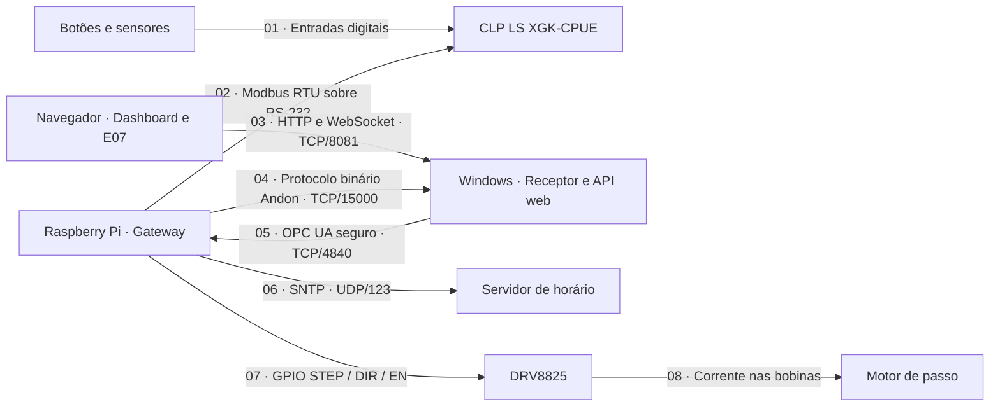

# Arquitetura de comunicação da linha

CLP LS XGK-CPUE · Raspberry Pi · Receptor Windows · Web Dashboard

O CLP executa o Ladder da linha. A Raspberry Pi faz a ponte entre a porta serial do CLP e a rede IP. O receptor Windows reúne eventos e telemetria, mantém o histórico e disponibiliza a Dashboard e a IT Digital E07 para o navegador.

## Visão geral

As setas indicam quem inicia a troca. Dados e respostas retornam ao solicitante quando o protocolo prevê resposta. A matriz identifica cada enlace pela numeração do diagrama.

O Gateway e o receptor têm bancos SQLite locais. O Gateway guarda a fila de entrega e o receptor grava os eventos e os dados do painel. Esses acessos a arquivos ocorrem dentro de cada equipamento.

[Matriz de conexões](#matriz-de-conexões) · [Fluxos de operação](#fluxos-de-operação) · [Dados em cada protocolo](#dados-em-cada-protocolo)

<!-- page -->

## Matriz de conexões

### Enlaces da operação

| Nº | Quem inicia → destino | Protocolo ou interface | Porta ou meio | O que trafega |
|---:|---|---|---|---|
| 01 | Botões/sensores → CLP | Entradas digitais cabeadas | Bornes de E/S | Níveis lógicos lidos pelo Ladder. `P00000–P0000B` aparecem em `BUTTONS` e outras entradas aparecem nas redes dos postos. |
| 02 | Gateway → CLP | Modbus RTU, cliente/servidor | RS-232 por adaptador USB–RS232 | Leitura de estados, tempos, produção e eventos. Escrita de ACK, relógio, base, Start e reset. Estação `1`, `115200`, `8N1`. |
| 03 | Navegador → Windows | HTTP e WebSocket (WS) | TCP `8081` no Windows analisado. `8080` no exemplo. | Páginas e API HTTP. Atualizações JSON em `/ws` e `/ws/instruction/e07`. |
| 04 | Gateway → receptor Windows | Protocolo binário Andon sobre TCP | TCP `15000` | Evento de 16 bytes. O receptor devolve ACK ASCII de 22 bytes depois de persistir. |
| 05 | Cliente no Windows → Gateway | OPC UA sobre `opc.tcp` | TCP `4840`, `/mock-linha/` | Assinatura de telemetria e chamadas de métodos. `Basic256Sha256` em `SignAndEncrypt`, com certificados de aplicação. |
| 06 | Gateway → servidor de horário | SNTP | UDP `123` | Consulta e resposta de hora. O Gateway converte para o fuso configurado e aplica o relógio ao CLP por Modbus. |
| 07 | Raspberry Pi → DRV8825 | Sinais digitais GPIO | `STEP` BCM 18, `DIR` BCM 25, `EN` BCM 15 | Pulsos de passo, direção e habilitação. `EN` é ativo em nível baixo. |
| 08 | DRV8825 → motor de passo | Acionamento elétrico | Saídas para as bobinas | Correntes controladas pelo driver. |

### Conexões locais e administrativas

| Quem inicia → destino | Protocolo e meio | Uso |
|---|---|---|
| Cliente GPIO da Raspberry → `pigpiod` | TCP `8888`, local na Raspberry | Interface do serviço para gerar os sinais do enlace 07, quando a saída de motor está habilitada. |
| Computador de manutenção → Raspberry Pi | SSH e SCP, TCP `22` | Administração e transferência do pacote do Gateway. |

As portas de aplicação são configuráveis. A tabela usa o modelo de implantação da Raspberry Pi e a porta web do arquivo local Windows. O `0.0.0.0` de um endpoint de escuta indica as interfaces locais. O cliente usa o endereço da máquina que hospeda o serviço ou `127.0.0.1` quando está na mesma máquina.

<!-- page -->

## Fluxos de operação

### Supervisão ao vivo

1. O Gateway lê por Modbus os tempos, estados, Andons e contador habilitados no mapa do CLP.
2. O cliente OPC UA do receptor recebe as alterações das variáveis por assinatura. `Linha/StatusProcesso` carrega os 12 estados e `Linha/TotalProduzido` carrega a contagem quando configurada.
3. O servidor web combina a telemetria e os registros do receptor e publica JSON ao navegador por `/ws`. A IT Digital E07 usa `/ws/instruction/e07` e acompanha o estado do P07.

### Entrega de um Andon

1. O CLP publica o evento em `D101–D108`, com disponibilidade em `D100`. O Gateway lê as oito palavras por Modbus, persiste os 16 bytes em sua fila SQLite e aciona `P10000`.
2. O Gateway abre uma conexão TCP com o receptor na porta `15000` e envia os bytes do evento. O receptor persiste a recepção e responde com o ACK de 22 bytes.
3. O Gateway confirma a entrega após receber o ACK válido. Em caso de falha, mantém o evento pendente para reenvio. O receptor reconhece reenvios idênticos.

O ACK local `P10000` confirma que o Gateway guardou o evento. O ACK TCP confirma que o receptor o persistiu. Eles ocorrem em enlaces e momentos diferentes.

### Comandos do operador

| Ação | Navegador → API Windows | Windows → Gateway (OPC UA) | Gateway → CLP (Modbus RTU) |
|---|---|---|---|
| Importar base | `POST /api/process/cycle-base` | `Linha/CarregarBaseCiclos` | FC16 escreve 288 palavras em 12 blocos e FC03 confere a leitura. |
| Start | `POST /api/process/start` | `Linha/IniciarSimulacao` | FC05 pulsa `P10002`. A confirmação do Ladder volta pelo mesmo caminho. |
| Limpar base | `POST /api/process/clear-base` | `Linha/LimparBase` | FC05 pulsa `P10003`. O Gateway confere a zeragem de `D16052` e os estados, quando configurados. |

### Hora e motor

O Gateway consulta a referência de hora por SNTP, grava o timestamp BCD em `D1000–D1003` e solicita sua aplicação com `P10001`. Para o motor, a combinação de `D112` e `D1200` define o comando aplicado à saída GPIO quando habilitada.

<!-- page -->

## Dados em cada protocolo

### Andon binário sobre TCP

Cada evento do CLP ocupa 16 bytes. Os campos de 16 bits usam ordem big-endian. Os oito bytes de data e hora usam BCD, em que cada dígito decimal ocupa quatro bits.

| Bytes | Campo |
|---|---|
| `0–1` | Tipo `00 01` no Gateway. O receptor também aceita `00 02` para eventos do simulador. |
| `2–3` | Posto, de `1` a `12`. |
| `4–11` | Mês, ano (dois últimos dígitos), hora, dia, segundo, minuto, século e dia da semana. |
| `12–13` | Botão. `1` Qualidade, `2` Equipamento, `3` Processo e `4` Material. |
| `14–15` | Estado. `1` ligado e `2` desligado. |

O ACK contém 20 caracteres ASCII `0` seguidos de `15`, sem quebra de linha. O dia da semana usa `0` para domingo e `6` para sábado.

### OPC UA e interface web

O cliente usa `opc.tcp://<gateway>:4840/mock-linha/` e o namespace `urn:mock-linha:telemetria:v1`. A publicação inclui quatro Andons, Takt time e último ciclo por posto, além dos nós de estado e produção da linha. Os métodos `Linha/DefinirVelocidadeMotor` e `Linha/DefinirParada` permitem a um cliente OPC UA escrever `D1200` e o bit `0` de `D1201` pelo Gateway.

O servidor web entrega as páginas e a API por HTTP na configuração de referência. A página abre WebSocket no mesmo host e porta. O JavaScript seleciona `wss` quando a página é servida por HTTPS.

### Integrações do modo simulado

| Quem inicia → destino | Protocolo | Uso |
|---|---|---|
| Simulador → receptor | TCP `15000` | Envio de Andon. Com `sync_on_start`, a mesma porta também aceita pedido de hora e devolve oito bytes BCD. |
| Receptor → servidor OPC UA do Simulador | OPC UA seguro, TCP `4840` | Assinatura de telemetria publicada pelo simulador. |
| Receptor → API de Start configurada | HTTP/HTTPS `POST` | Rota alternativa de Start quando `[desktop_api].start_url` está preenchida. |
| Cliente de eventos do simulador → receptor | HTTP `POST /api/runtime/events` | API para receber eventos da simulação, como ciclos, planos e sessões. |

### Fontes do projeto

[Referência do CLP](../Documentacao_Tecnica/DOCUMENTACAO_CLP_LS_XGK.md) · [Guia da Raspberry Pi](../../hardware/README_INSTALACAO_RASPBERRY.md) · [Configuração de implantação](../../hardware/deploy/config.raspberry.toml) · [Receptor Windows](../../simulador/tools/reference_receiver.py) · [Servidor web](../../simulador/web/dashboard.py) · [Protocolo Andon](../../simulador/protocol/tcp_codec.py)
