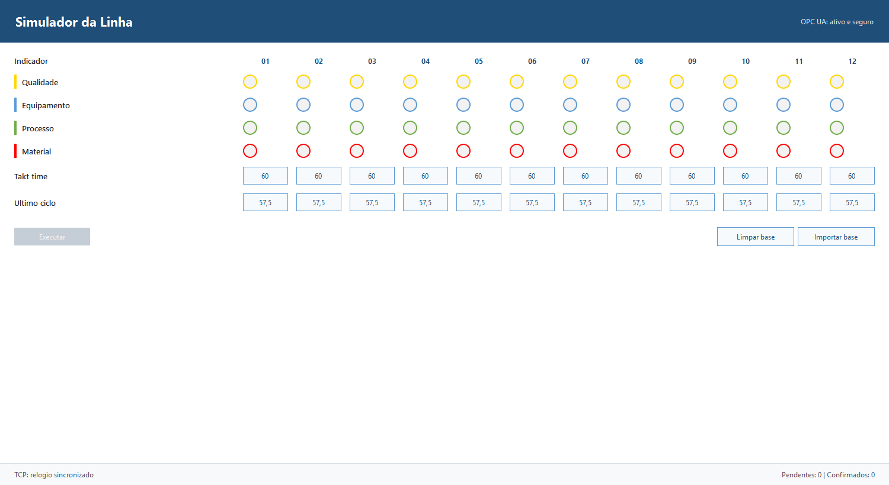
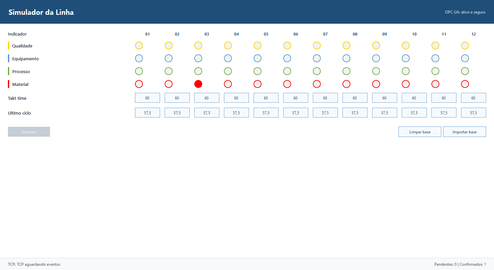
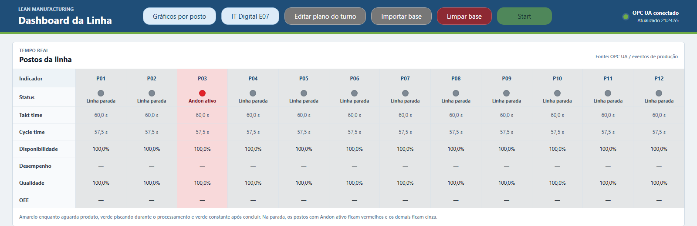

# Documentação técnica — Desktop (Simulador da Linha)

**Código:** `simulador/main.py`, `app/`, `ui/`, `services/simulation.py`, `persistence/`, `communications/tcp_sender.py`, `communications/opcua_server.py`
**Execução:** `simulador/run_mock.ps1` · **Configuração:** `simulador/config.toml`

## 1. Função

O Desktop é um aplicativo PyQt6 que **substitui o CLP e o Gateway** quando o hardware não está disponível. Ele usa os mesmos protocolos do Gateway: envia cada Andon pelo protocolo binário de 16 bytes ao receptor por TCP e publica a telemetria no mesmo servidor OPC UA seguro, com os mesmos 72 NodeIds. Por isso o receptor e a Dashboard funcionam sem nenhuma alteração, tanto com a linha real quanto com o simulador.

## 2. Arquitetura interna

| Camada | Componente | Responsabilidade |
|---|---|---|
| Interface | `ui/main_window.py`, `ui/station_grid.py`, `ui/andon_button.py` | Janela com 12 postos × 4 Andons, campos de Takt e último ciclo, botões **Executar**, **Importar base** e **Limpar base**, rodapé com estado do TCP e da fila. |
| Serviço | `services/simulation.py` | Converte o clique em transação: novo estado + pacote de 16 bytes, gravados juntos. |
| Persistência | `persistence/database.py`, `persistence/outbox.py` | SQLite (`data/mock_line.db`) em *thread* própria; tabelas `andon_state` (48 linhas) e `outbox_event` (fila). |
| Comunicação | `communications/tcp_sender.py` | Entrega FIFO, um evento por vez, aguardando o ACK de 22 bytes. |
| Comunicação | `communications/opcua_server.py` | Servidor OPC UA `opc.tcp://0.0.0.0:4840/mock-linha/`, `Basic256Sha256` + `SignAndEncrypt`. |
| Domínio | `domain/clock.py`, `protocol/tcp_codec.py`, `protocol/bcd.py` | Relógio lógico, codificação do pacote e BCD. |

## 3. Comportamento

- **Clique atômico.** Um clique registra uma única data e hora lógica, alterna somente o botão escolhido e grava o estado e o pacote **na mesma transação**. A interface só muda depois do `COMMIT`. Se o banco falhar, nada muda e uma mensagem é exibida.
- **Categorias independentes.** As quatro categorias de um posto podem ficar ligadas ao mesmo tempo, e cada mudança gera um evento próprio.
- **Fila FIFO durável.** Somente um evento fica em trânsito. As esperas de nova tentativa são 1, 2, 5, 10 e 30 s, e depois permanecem em 30 s. Ao reiniciar, os estados são restaurados e o primeiro pendente é retomado.
- **Telemetria manual.** Editar Takt ou Último ciclo habilita **Executar**, que publica os 24 valores no OPC UA.
- **Importar base.** Aceita `.xlsx`, `.xlsm` e `.csv`, com os postos P01–P12 na primeira linha ou coluna seguidos de pares Takt/Último ciclo. Publica um par por segundo. Há 26 planilhas de exemplo em `bases_exemplo/`.
- **Relógio.** Com `sync_on_start = true`, o Desktop envia `00 01` + 14 bytes zero ao receptor, recebe 8 bytes BCD e passa a usar `time.monotonic()`. O relógio do Windows não é alterado.

## 4. Configuração relevante (`config.toml`)

| Seção | Chave | Valor de referência | Efeito |
|---|---|---|---|
| `[application]` | `database_path` | `data/mock_line.db` | Banco do simulador. |
| `[application]` | `takt_time_seconds` / `last_cycle_seconds` | 60,0 / 57,5 | Valores iniciais dos 24 campos. |
| `[tcp]` | `host` / `port` | `127.0.0.1` / 15000 | Receptor de destino. |
| `[tcp]` | `sync_on_start` | `false` | Pede a hora ao receptor na partida. |
| `[opcua]` | `endpoint` | `opc.tcp://0.0.0.0:4840/mock-linha/` | Servidor OPC UA do simulador. |
| `[opcua]` | `trusted_clients_dir` | `certificates/trusted/clients` | Certificados de cliente aceitos. |

## 5. Evidências

| Evidência | Resultado | Fonte |
|---|---|---|
| Janela ao iniciar | 48 Andons desligados, Takt 60 s, ciclo 57,5 s, "OPC UA: ativo e seguro" | Figura 1 |
| Andon P03 Material acionado | Botão aceso; rodapé "Pendentes: 0, Confirmados: 1" | Figura 2 |
| Dashboard alimentada pelo Desktop | Coluna P03 vermelha ("Andon ativo") | Figura 3 |
| Log do receptor (21/11/2026) | `20:24:51 posto=03 botao=Material estado=ON resultado=ON ACK=enviado` e `20:25:09 ... OFF ... ACK=enviado` | `receiver` (terminal) |
| Latência da fila | 2 eventos confirmados em 11,5 e 10,5 ms, `attempts = 0` | `outbox_event` (banco da demonstração) |
| Histórico do simulador | 4 eventos em 21/11/2026 20:01–20:02, confirmados entre 10,5 e 14,5 ms | `simulador/data/mock_line.db` |
| Testes automatizados | `test_database` (4), `test_tcp_sender` (1), `test_ui` (4), `test_tcp_codec` (5), `test_bcd` (11): todos aprovados | `pytest -v`, 21/11/2026 |

**Figura 1.** Janela do Simulador ao iniciar.

**Figura 2.** Andon de Material do P03 aceso e evento confirmado.

**Figura 3.** Dashboard recebendo o mesmo Andon.

Pacote do Andon ON gravado pelo Desktop: `00 01 00 03 11 26 20 21 50 24 20 06 00 04 00 01`. Ele se lê assim: tipo 1, posto 03, 21/11/(20)26 20:24:50, sábado, botão 4 (Material), estado 1 (ligado).

## 6. Limites

- O protocolo não tem identificador de evento. Se a conexão cair depois que o receptor confirmar, mas antes de o ACK chegar, o mesmo pacote é reenviado. O receptor o reconhece pela tabela `processed_event` e devolve novo ACK sem aplicá-lo de novo.
- O simulador não reproduz as máquinas de estados dos postos: o fluxo de produção da Dashboard vem do CLP, ou do endpoint `POST /api/runtime/events` no modo simulado.

Relatório completo: `docs/Relatorio_Final/` (seção 5).
