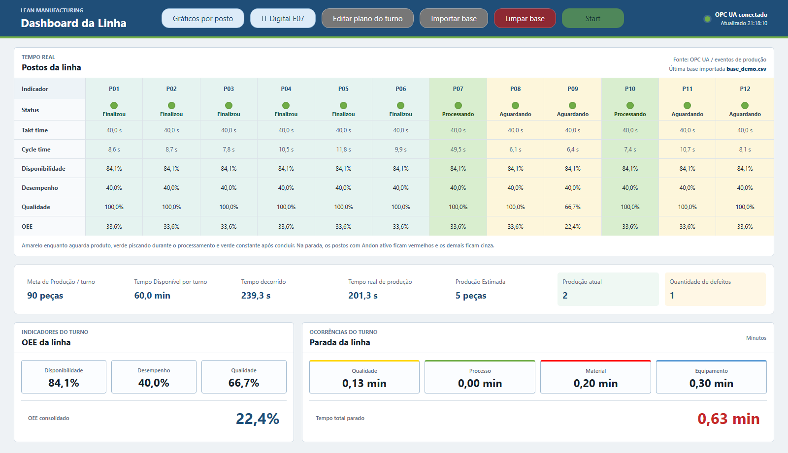
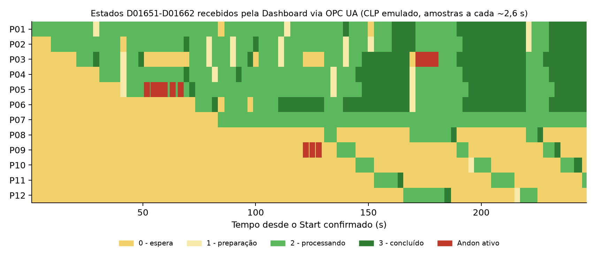
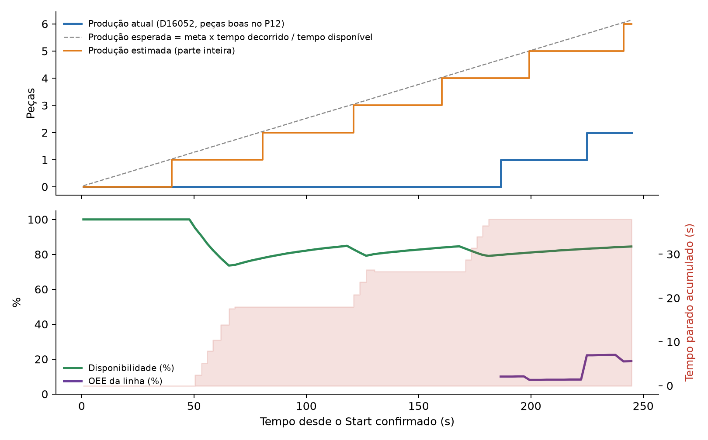

# Documentação técnica — Dashboard web

**Código:** `simulador/web/dashboard.py`, `web/templates/`, `web/static/`, `services/analytics.py`, `services/telemetry.py`, `tools/reference_receiver.py`
**Execução:** `simulador/run_receiver.ps1`, que sobe o receptor TCP, o cliente OPC UA e a Dashboard. **Endereço:** `http://<servidor>:8081`

## 1. Função

A Dashboard é a tela de acompanhamento da linha. Ela reúne a telemetria do Gateway (OPC UA) e os eventos persistidos pelo receptor (TCP 15000) e calcula os indicadores do turno: Disponibilidade, Desempenho, Qualidade, OEE e paradas por categoria. Também é por ela que o operador envia os comandos ao CLP: **Importar base**, **Start** e **Limpar base**.

## 2. Arquitetura

```
Gateway ──OPC UA (assinatura)──► OpcUaClientWorker ──► TelemetryStore ─┐
Gateway ──TCP 16 bytes─────────► ReferenceServer ───► SQLite ──────────┤
                                                                        ├─► snapshot() ─► FastAPI ─► /ws (1 s) ─► navegador
                                         services/analytics.py ◄───────┘
```

- `TelemetryStore` guarda o último valor de cada nó. A conexão é considerada ativa enquanto a última notificação tiver menos de `opcua_stale_seconds` (10 s).
- `ReceiverDatabase` (`reference_receiver.db`) guarda as tabelas `reception`, `stop_occurrence`, `processed_event`, `key_reference`, `defect_item`, `production_cycle`, `production_plan`, `process_configuration`, `runtime_meta` e `runtime_receipt`.
- O servidor é FastAPI + uvicorn em uma *thread* própria. As páginas são HTML estático com JavaScript (`dashboard.js`, `process.js`, `station-chart.js`, `instruction.js`), e cada arquivo é servido com um *hash* de conteúdo para evitar cache antigo.

## 3. Telas

| Tela | Conteúdo |
|---|---|
| `/` Dashboard | Tabela "Postos da linha" (status, Takt, Cycle time, Disponibilidade, Desempenho, Qualidade, OEE por posto); faixa de plano (meta, tempo disponível, decorrido, produtivo, produção estimada, produção atual, defeitos); "OEE da linha"; "Parada da linha" por categoria. |
| `/graficos` | Barras do último ciclo ou do Takt por posto, com consulta dos valores. |
| `/instrucao/e07` | IT Digital E07 (ver `05_IT_Digital.md`). |

**Cores da coluna de cada posto** (`D01651`–`D01662`): amarelo nos estados 0 e 1, verde piscando no estado 2 e verde constante no 3. Com qualquer Andon ativo, o posto em parada fica vermelho e os demais cinza ("Linha parada").

## 4. Indicadores (`services/analytics.py`, revisão `2026-11-20.01`)

Período: do Start confirmado (ou do último reset) até agora. Sejam T o tempo decorrido, S o tempo parado (união dos intervalos de Andon), M a meta, Td o tempo disponível (min), B as peças boas (contador do P12, `D16052`) e D os defeitos (Andon de Qualidade ligado).

| Indicador | Fórmula |
|---|---|
| Produção esperada | `M × T / (60 × Td)` |
| Produção estimada | parte inteira da esperada |
| Disponibilidade | `100 × (T − S) / T` |
| Desempenho | `100 × B / produção estimada` (exibido com B > 0 e estimada > 0) |
| Qualidade | `100 × B / (B + D)` |
| OEE | `Disponibilidade × Desempenho × Qualidade / 10⁴` |

Paradas sobrepostas não são somadas duas vezes. Os minutos por categoria são calculados separadamente, e a sobreposição é informada à parte (`downtime_overlap_minutes`).

## 5. Comandos ao CLP

| Botão | Pré-condição | Caminho |
|---|---|---|
| Importar base | Planilha com 12 ciclos por posto (0,1 a 6553,5 s, uma casa decimal), até 1 MB | `POST /api/process/cycle-base` → `Linha/CarregarBaseCiclos` → FC16 em `D17001`–`D17288` + conferência FC03 |
| Start | Base conferida, 12 postos no estado 0, nenhum Andon | `POST /api/process/start` → `Linha/IniciarSimulacao` → pulso de 2 s em `P10002`; confirmação = algum posto no estado 2 (até 8 s) |
| Limpar base | — | `POST /api/process/clear-base` → `Linha/LimparBase` → pulso de 2 s em `P10003`; confere `D16052 = 0`; apaga produção, defeitos e paradas do dia |

Comandos vindos de outra origem são recusados com 403, e só um comando é executado por vez (409).

## 6. Evidências

**Demonstração ponta a ponta (21/11/2026): Gateway real + CLP emulado.** Plano de 90 peças em 60 min (Takt de 40 s); base `base_demo.csv` com o P07 em 36 s.

| Momento | O que a Dashboard mostrou | Imagem |
|---|---|---|
| Linha em operação | P01 e P04–P07 processando (verde), demais aguardando (amarelo) | `dash_06_p07_processando.png` |
| Andon de Equipamento no P05 (50 s após o Start) | Coluna P05 vermelha, demais "Linha parada"; Disponibilidade 81,4 %; 0,19 min de Equipamento | `dash_02_andon_p05.png` |
| Fim (239,3 s) | 2 peças, 1 defeito (Qualidade no P09), 0,63 min parados, OEE 22,4 % | `dash_03_final.png` |
| Gráficos | P07 com 49,5 s (gargalo) contra Takt de 40 s | `dash_04_graficos.png` |
| Após Limpar base | 12 postos aguardando, indicadores zerados, Start habilitado | `dash_05_apos_limpar.png` |

**Conferência do OEE final.** T = 239,3 s e S = 38,0 s, logo Disponibilidade = (239,3 − 38,0)/239,3 = **84,1 %**. Estimada = ⌊90 × 239,3/3600⌋ = 5, logo Desempenho = 2/5 = **40,0 %**. Qualidade = 2/3 = **66,7 %**. OEE = 0,841 × 0,400 × 0,667 = **22,4 %**. Todos os valores são idênticos aos exibidos.







**Dados reais do receptor** (`simulador/data/reference_receiver.db`): 127 recepções (64 ON, 63 OFF) entre 27/09 e 21/11/2026, sendo 18 delas os eventos reais do CLP. Delas resultaram 64 ocorrências de parada, todas encerradas (23 de Equipamento, 17 de Qualidade, 17 de Processo e 7 de Material), e 17 defeitos.

**Testes:** `test_analytics` (6), `test_web_dashboard` (2), `test_process_configuration` (41), `test_telemetry` (3): todos aprovados.

Relatório completo: `docs/Relatorio_Final/` (seção 6).
