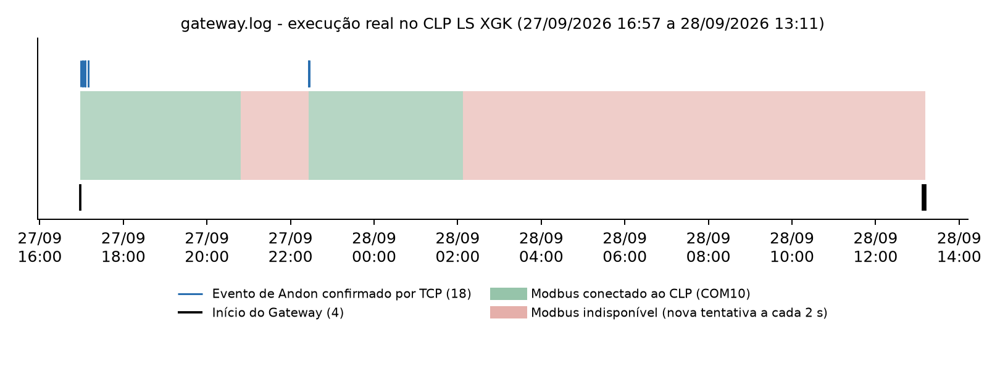
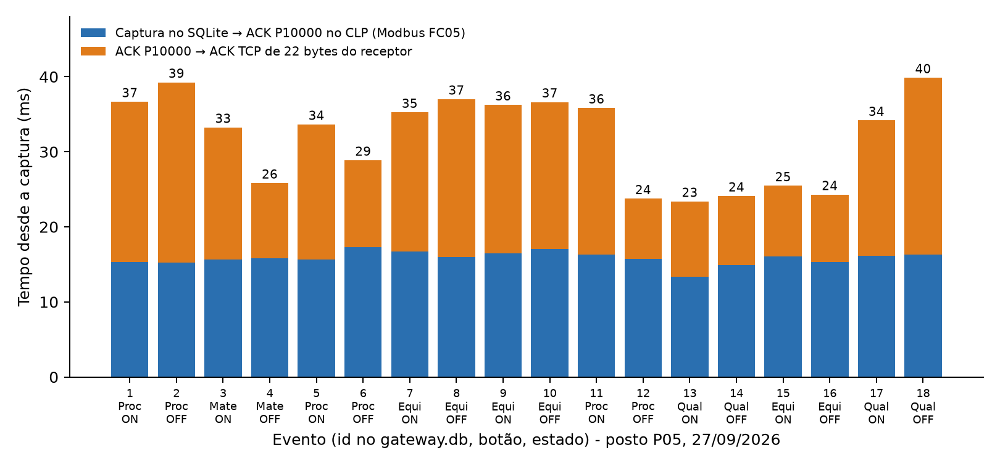

# Documentação técnica — Raspberry Pi (Gateway de borda)

**Código:** `hardware/` · **Entrada:** `hardware/main.py --config <arquivo> [--stop-file <arquivo>]`
**Implantação:** `hardware/deploy/install.sh`, `deploy/gateway.service`, `deploy/config.raspberry.toml`
**Guia passo a passo:** `hardware/README_INSTALACAO_RASPBERRY.md` (17 seções)

## 1. Função

Serviço Python sem interface gráfica que faz a ponte entre a porta serial do CLP LS XGK e a rede IP:

1. Lê o CLP por **Modbus RTU** (RS-232, via adaptador USB-RS232) a cada 250 ms.
2. Guarda cada evento de Andon em uma **fila SQLite durável** antes de confirmar ao CLP (`P10000`).
3. Entrega os eventos ao receptor por **TCP** (16 bytes + ACK de 22 bytes).
4. Publica a telemetria em um **servidor OPC UA** seguro e recebe comandos (base, Start, reset, motor).
5. Atualiza o relógio do CLP a partir do **SNTP**.
6. Comanda o **motor de passo** da esteira pelo DRV8825 (GPIO).

## 2. Módulos

| Módulo | Responsabilidade |
|---|---|
| `application.py` | Partida e parada ordenadas; arquivo de parada e sinais do sistema. |
| `plc_poller.py` | Ciclo de leitura; captura → COMMIT → `P10000`; fila de comandos serializada na *thread* da serial. |
| `modbus_transport.py` | `pymodbus` RTU: FC03, FC04, FC05, FC06, FC16; fecha a porta em qualquer erro. |
| `register_map.py` | Decodifica `D100`–`D160` (evento, Andons em *nibbles*, motor, UInt32 de tempos). |
| `cycle_control.py` | Base de tempos (12 × 24 palavras), Start (pulso de 2 s, confirmação em até 8 s), reset (pulso de 2 s, `D16052 = 0`). |
| `persistence.py` | SQLite `WAL` + `synchronous=FULL`; UID = Gateway + carimbo + CRC32; sempre compara os 16 bytes. |
| `tcp_sender.py` | Um evento por vez, confirmado somente com ACK válido; nova tentativa com espera crescente. |
| `opcua_server.py`, `security.py` | 74 variáveis e 6 métodos; `Basic256Sha256` / `SignAndEncrypt`; validação do certificado de cliente. |
| `ntp_client.py`, `plc_clock.py` | SNTP com validação de modo, versão, *stratum* e origem; BCD de `DATEWR`. |
| `motor_output.py` | Rampa, frequência proporcional a `D1200`, desabilitação segura. |

## 3. Garantias de entrega

- O evento é gravado com `synchronous=FULL` **antes** de `P10000`. Se a energia cair entre os dois, o CLP reapresenta o evento e o Gateway o reconhece pelos 16 bytes, sem duplicar.
- A fila TCP é global, persistente e FIFO, e os pendentes sobrevivem a reinícios.
- O evento só é confirmado após o ACK ASCII de 22 bytes do receptor.
- Uma colisão de CRC32 nunca descarta dados, porque os bytes originais sempre são comparados.
- A telemetria de alta frequência fica em memória, o que reduz a escrita no cartão SD.

## 4. Instalação na Raspberry Pi

```bash
ls -l /dev/serial/by-id/                      # identifica o adaptador USB-RS232
cd ~/Gateway
sudo bash deploy/install.sh 192.168.1.10 /dev/serial/by-id/usb-FTDI_..._port0 LINHA_A
sudo systemctl status gateway --no-pager
sudo journalctl -u gateway -f
```

O instalador cria o usuário `gateway` (grupo `dialout`), instala em `/opt/lean-gateway` com `.venv` e grava `/etc/lean-gateway/config.toml` (que nunca é sobrescrito). Também habilita `gateway.service`, com `Restart=always`, `RestartSec=3`, `ProtectSystem=strict`, `ProtectHome=true` e `NoNewPrivileges=true`, e escrita permitida só em `/var/lib/lean-gateway` e `/var/log/lean-gateway`.

## 5. Motor (DRV8825)

| Sinal | GPIO (BCM) | Observação |
|---|---|---|
| STEP | 18 | *Duty cycle* de 50 % |
| DIR | 25 | Sentido fixo (`clockwise_high`) |
| EN | 15 | Ativo em nível baixo, *pull-up* externo de 10 kΩ para 3V3 |

Com `D112 = 1` e `D1200 > 0`: `f = 100 + (5000 − 100) × D1200/100` Hz, com rampa de 0,5 s (ex.: `D1200 = 60` dá 3040 Hz). `D112 = 0` ou `D1200 = 0` desaceleram e desabilitam EN. Uma falha de leitura desabilita EN imediatamente. É preciso ter o daemon `pigpiod` instalado e ativo.

## 6. Configuração Modbus de implantação

`baudrate 115200`, `8N1`, `device_id 1`, `poll_interval 0,25 s`, `uint32_word_order low_high`, `time_scale_to_seconds 0,1`, `process_status_address 651`, `production_count_address 15052`, `cycle_base_address 16001`, `simulation_start_address 2`, `reset_base_address 3`, `ack_address 0` (coil).

## 7. Evidências

### 7.1 Execução real com o CLP (27–28/09/2026, `hardware/logs/gateway.log` e `hardware/data/gateway.db`)

| Registro | Ocorrências |
|---|---|
| `Gateway LINHA_A started` | 4 |
| `Modbus: connected` | 4 |
| `OPC UA: active and secure` | 4 |
| `SNTP: synchronized` | 2 |
| `TCP: event N confirmed` | 18 (eventos 1 a 18, em ordem) |
| `Modbus: unavailable` | 9 |
| `could not open port 'COM10'` | 4.444 (reconexão a cada 2 s com o adaptador desconectado) |
| Encerramento ordenado (`Stop file received` … `Gateway stopped`) | 1 |

- **Latência real:** ACK ao CLP entre 13,4 e 17,3 ms (mediana 15,9) e entrega TCP entre 23,4 e 39,9 ms (mediana 33,9). Nenhum evento precisou de nova tentativa.
- **Recuperação:** a comunicação caiu às 20:48 e voltou às 22:26:21. Os 4 eventos gerados nesse intervalo (22:19) ficaram na FIFO do CLP e foram capturados em 22:26:21,69 / 21,91 / 22,17 / 22,42, um a cada ciclo de 250 ms, em ordem e sem perda. O SNTP sincronizou o relógio 2 s depois.





### 7.2 Gateway real contra CLP emulado (21/11/2026)

O Gateway foi executado **sem alteração de código** contra `clp_emulado.py`, um servidor Modbus RTU com o mesmo mapa do Ladder. Só a porta mudou para `socket://127.0.0.1:5020`.

- Sem NTP disponível, aplicou a hora do sistema uma única vez: `D1000`–`D1003 = 0x1126 0x2021 0x5313 0x2006`, ou seja, 21/11/26 20:13:53, sábado.
- Gravou e conferiu as 288 palavras da base (≈5,3 s). Start confirmado pelo estado 2 do P01 (≈3,0 s). Reset confirmado com `D16052 = 0` (≈2,7 s).
- Entregou 6 eventos: ACK ao CLP entre 15,1 e 17,3 ms e TCP entre 21,3 e 46,4 ms.

### 7.3 Testes

66 testes no Gateway: 64 aprovados e 2 pulados (dependem de `gpiozero`, presente só na Raspberry). Destaques: `test_commit_always_happens_before_p1000`, `test_failed_p1000_is_retried_without_losing_persisted_event`, `test_pending_event_survives_database_restart`, `test_crc_uid_collision_never_discards_a_different_payload`, `test_applies_d112_and_d1200_with_ramps_and_disables_on_shutdown`.

Relatório completo: `docs/Relatorio_Final/` (seção 4).
