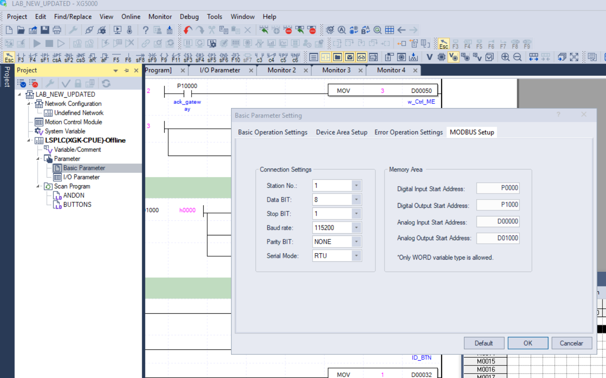
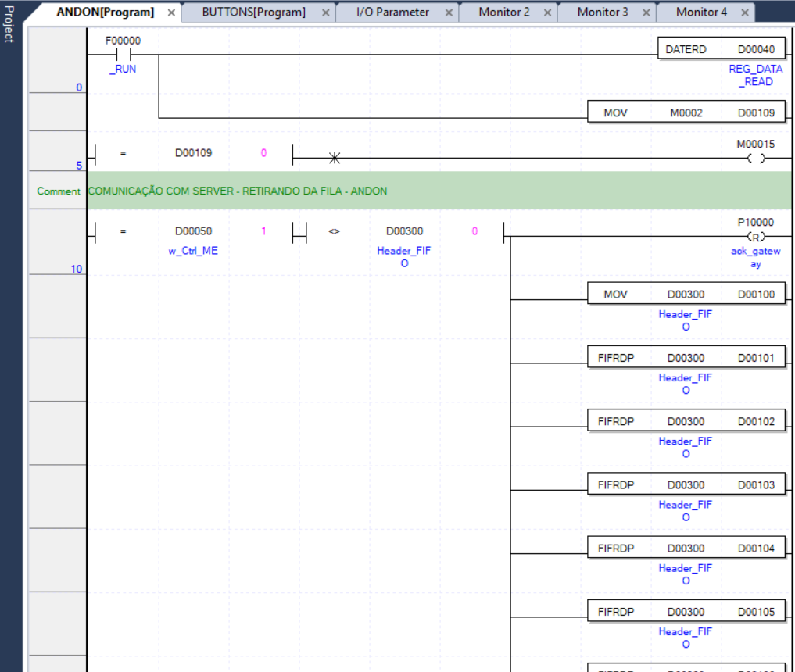
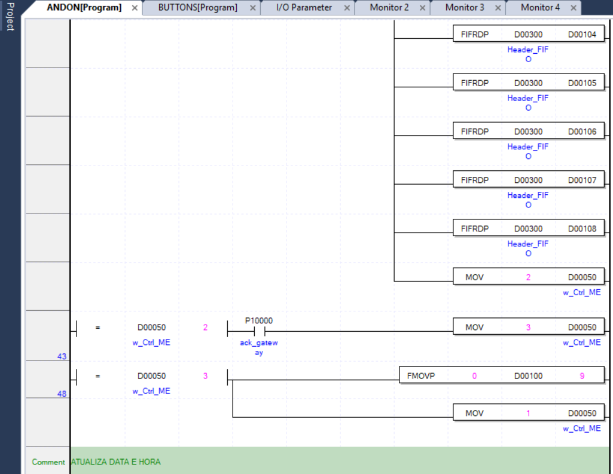

# Documentação técnica — CLP LS XGK-CPUE

**Projeto Ladder:** `LAB_NEW_UPDATED` · **Software:** XG5000 4.74 · **CPU:** LS XGK-CPUE
**Referências detalhadas:** `docs/Documentacao_Tecnica/DOCUMENTACAO_CLP_LS_XGK.md` (21 capturas comentadas) e `docs/Fluxogramas/FLUXOGRAMA_MAQUINA_ESTADOS_CLP.md` (máquinas de estados)

## 1. Organização do programa

| Programa | Função |
|---|---|
| `BUTTONS` (scan) | Bordas das entradas `P00000`–`P0000B` em um único registrador de estados (`D01501`) e geração das marcas `M00020`… |
| `ANDON` (scan) | Relógio (`DATERD`/`DATEWRP`), fila de comunicação com o Gateway, máquinas de estados dos 12 postos e comando do motor. |
| `MENSAGEM_ANDON` (sub-rotina) | Grava cada evento (8 palavras) na FIFO `D00300` com `FIWR`. |

Comunicação: **Modbus RTU escravo**, estação 1, 115200 baud, 8N1 (*Basic Parameter → MODBUS Setup*).

## 2. Mapa Modbus (contrato com o Gateway)

| XG5000 | Função | Endereço | Conteúdo |
|---|---|---:|---|
| `D00100` | FC04 | 100 | Palavras pendentes (0, 8, 16…) |
| `D00101`–`D00108` | FC04 | 101–108 | Evento de 16 bytes (`D00101 = 1`) |
| `D00109`–`D00111` | FC04 | 109–111 | Andons: 4 postos por palavra, bit 0 Qualidade, 1 Equipamento, 2 Processo, 3 Material |
| `D00112` | FC04 | 112 | Motor: 1 ligado, 0 desligado |
| `D00113`–`D00160` | FC04 | 113–160 | Por posto: Takt e último ciclo, UInt32 palavra baixa primeiro, décimos de segundo |
| `D01000`–`D01003` | FC16 | 0–3 | Relógio BCD (mês/ano, hora/dia, segundo/minuto, século/dia da semana) |
| `D01200` | FC03/06 | 200 | Velocidade do motor (0–100) |
| `D01201.0` | FC03/06 | 201 | Pedido de parada |
| `D01651`–`D01662` | FC03 | 651–662 | Estado dos postos P01–P12 |
| `D16052` | FC03 | 15052 | Contador de produção (P12) |
| `D17001`–`D17288` | FC16/03 | 16001–16288 | Base de tempos (24 palavras por posto) |
| `P10000` | FC05 | coil 0 | ACK do evento |
| `P10001` | FC05 | coil 1 | Aplicar relógio |
| `P10002` | FC05 | coil 2 | Start (pulso de 2 s) |
| `P10003` | FC05 | coil 3 | Reset (pulso de 2 s) |

## 3. Botões e eventos de Andon

**BUTTONS.** `D01501` começa em 100. Para a entrada *n* (1–12), a sequência é `100 →(descida) n →(subida) n+12 →(descida) n+24 →(subida) 100`. A marca do botão fica ativa nos três estados intermediários.

**Fila (`D00050`).**

| Estado | Condição | Ação |
|---|---|---|
| 1 – espera | `D00300 ≠ 0` | Copia o cabeçalho para `D00100` e retira 8 palavras para `D00101`–`D00108` (`FIFRDP`); vai para 2. |
| 2 – publicado | `P10000 = 1` (Gateway) | Vai para 3. |
| 3 – limpeza | — | `FMOVP 0 D00100 9`; volta para 1. |

Consequência: **um evento por vez, liberado somente após o ACK do Gateway.** Se o Gateway estiver desconectado, os eventos se acumulam na FIFO e são entregues em ordem na reconexão.

## 4. Máquinas de estados dos postos

Estados em `D01651`–`D01662`: **0** espera, **1** preparação, **2** medição (processando), **3** fim do ciclo.

| Posto | Entrada | Passagem 2 → 3 | Registro na passagem 3 → 0 |
|---|---|---|---|
| P01 | `M00101` (Start) | Fim de `T0001`, com *preset* `D17001[Z001]` | `T0001 → D00115`, `INC D16041`, ativa P02 |
| P02 | `M00102` | Fim de `T0002`, com *preset* `D17025[Z002]` | `T0002 → D00119`, `INC D16042` |
| P07 (manual) | `M00107` | Borda de `P0000D` | `T0007 → D00139`, `INC D16047` |
| P08 (auto) | `P0000D` + `T0020` | Borda de `P0000C` | `T0008 → D00143`, `INC D16048` |
| P09 (auto) | `P0000C` + `T0021` | Borda de `P0000F` | `T0009 → D00147`, `INC D16049` |
| P10 (auto) | `P0000F` + `T0022` | Borda de `P0000E` | `T0010 → D00151`, `INC D16050`, sinal `M0011B` ao P11 |

- **Start:** borda de `P10002` → `M00101`.
- **Reset:** borda de `P10003` → zera estados, temporizadores, contadores e índices `Z`.
- **Motor:** `D00112.0 = 1` quando `D01501 = 100` (nenhum botão pressionado) e algum dos postos P08–P10 está com estado ≠ 0.
- **IT Digital:** a transição do P07 para o estado 2 (`D01657`) inicia a sequência da instrução E07.

## 5. Evidências

**Eventos reais lidos do CLP (27/09/2026, `hardware/data/gateway.db`):** 18 eventos do posto P05 (6 de Processo, 6 de Equipamento, 4 de Qualidade e 2 de Material, em pares ON/OFF).

Decodificação do evento 1, `00 01 00 05 09 26 16 27 03 59 20 00 00 03 00 01`:

| Bytes | Valor | Significado |
|---|---|---|
| 0–1 | `00 01` | Evento de Andon do CLP |
| 2–3 | `00 05` | Posto P05 |
| 4–5 | `09 26` | Setembro de (20)26 |
| 6–7 | `16 27` | 16 h, dia 27 |
| 8–9 | `03 59` | 59 min 03 s |
| 10–11 | `20 00` | Século 20, domingo (0) |
| 12–13 | `00 03` | Processo |
| 14–15 | `00 01` | Ligado |

Resultado: "P05, Processo, ligado, 27/09/2026 16:59:03", igual ao gravado pelo Gateway e pelo receptor (recebido às 16:59:04,04).

- **Handshake:** ACK `P10000` escrito entre 13,4 e 17,3 ms após a captura (mediana 15,9 ms).
- **FIFO durante a queda de comunicação:** os eventos 13–16 (gerados às 22:19, com o Gateway sem comunicação desde 20:48) foram entregues na reconexão das 22:26:21, um a cada 250 ms, na ordem original.
- **Relógio:** a escrita de `D01000`–`D01003` com `P10001` foi verificada no CLP emulado (`0x1126 0x2021 0x5313 0x2006` = 21/11/26 20:13:53, sábado).

## 6. Pontos a confirmar

- As capturas mostram as redes completas de P01, P02 e P07–P10 e o início do P11. As redes dos postos P03–P06 e P12 precisam ser conferidas no projeto Ladder.
- `simulation_running_address` não está configurado. O Start é confirmado pelo estado 2 de algum posto.

Relatório completo: `docs/Relatorio_Final/` (seção 3 e Anexo).
