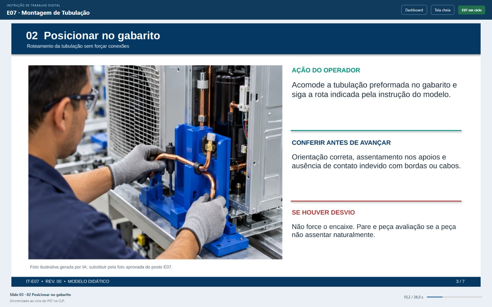
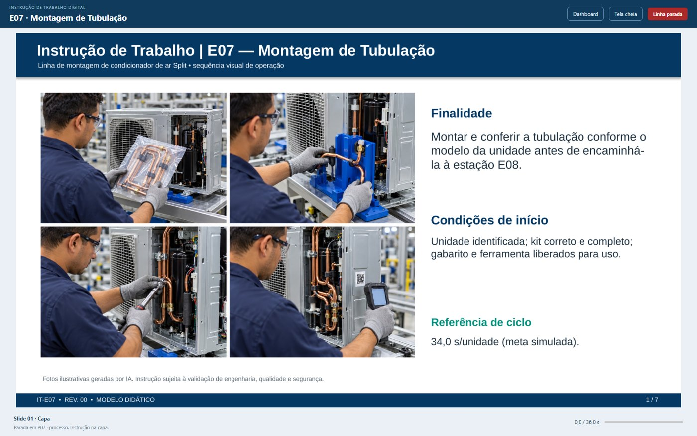
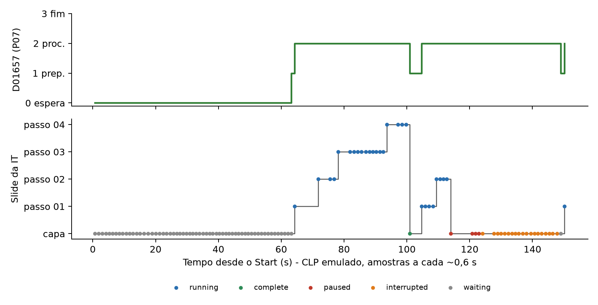

# Documentação técnica — IT Digital E07 (Instrução de Trabalho Digital)

**Código:** `simulador/domain/work_instruction.py`, `services/plc_work_instruction.py`, `services/telemetry.py` (`instruction_snapshot`), `web/templates/instruction.html`, `web/static/instruction.js`, `web/static/instructions/e07/slide-01.png` … `slide-05.png`
**Endereço:** `http://<servidor>:8081/instrucao/e07` (botão **IT Digital E07** da Dashboard)

## 1. Função

Substitui a instrução impressa do posto **E07 – Montagem de Tubulação** por uma tela que avança sozinha, **sincronizada com o ciclo real do posto 07 no CLP**. O operador vê o passo certo no momento certo, sem precisar tocar na tela.

| Slide | Conteúdo | Intervalo do ciclo |
|---|---|---|
| 1 | Capa: finalidade, condições de início e referência de ciclo | fora do ciclo |
| 2 | 01 Conferir unidade e kit | 0–7 s |
| 3 | 02 Posicionar no gabarito | 7–14 s |
| 4 | 03 Fixar as conexões | 14–29 s |
| 5 | 04 Inspecionar e registrar | 29–36 s |

Cada passo mostra **Ação do operador**, **Conferir antes de avançar** e **Se houver desvio**.

## 2. Fluxo de dados

`D01657` (CLP) → Gateway (Modbus FC03, 250 ms) → OPC UA `Linha/StatusProcesso` → receptor (`TelemetryStore`) → `PlcWorkInstruction` (relógio monotônico do receptor) → WebSocket `/ws/instruction/e07` (100 ms) → navegador.

## 3. Regras

| Situação | Estado da IT | Tela |
|---|---|---|
| P07 **muda** para 2 | `running`, slides 2→5 por tempo (7, 14, 29, 36 s) | "E07 em ciclo – Sincronizado ao ciclo do P07 no CLP" |
| P07 sai do 2, ou a sequência atinge 36 s | `complete` | Capa; aviso se o ciclo durou menos que 36 s |
| Qualquer Andon ativo | `paused` | Capa – "Linha parada – Parada em Pnn · categoria" |
| Andon liberado no meio do ciclo | `interrupted` | "Aguardando próximo ciclo" (não retoma o ciclo interrompido) |
| Receptor conectado com o P07 já em 2 | `waiting` | Espera a próxima entrada no estado 2, porque não se sabe quando o ciclo começou |
| Sem OPC UA | `disconnected` | "Sem sincronização" |

Estado exposto em `GET /api/instruction/e07`, por exemplo:

```json
{"station": 7, "source": "plc", "slide": 4, "status": "running", "cycle_id": "plc-p07-4",
 "elapsed_seconds": 28.59, "cycle_time_seconds": 0, "short_cycle": false,
 "stop_station": null, "stop_category": "", "sequence": 4}
```

## 4. Evidências (Gateway real + CLP emulado, 21/11/2026)

Estado da IT e do P07 lidos a cada ~1,1 s (mediana; o rótulo da figura traz o valor nominal de 0,6 s):

| t (s) | D01657 | IT | No ciclo (s) | Esperado (s) |
|---:|---|---|---:|---:|
| 64,2 | 1 → 2 | slide 2 | 0,4 | 0 |
| 71,8 | 2 | slide 3 | 7,9 | 7 |
| 78,1 | 2 | slide 4 | 14,1 | 14 |
| 93,6 | 2 | slide 5 | 29,7 | 29 |
| 100,9 | → 1 | concluído, capa | 36,0 | 36 |
| 114,0 | 2 | **linha parada** (Andon de Processo no P07) | – | – |
| 124,0 | 2 | aguardando próximo ciclo | – | – |
| 150,2 | 1 → 2 | novo ciclo `plc-p07-3`, slide 2 | 0,5 | 0 |

As trocas ocorreram entre 0,1 e 0,9 s após o limite teórico, uma diferença compatível com a amostragem do teste (~1,1 s) somada ao ciclo de leitura do Gateway (250 ms).





**Testes:** `test_work_instruction.py` (4 aprovados): sequência de 36 s, interrupção por Andon até o próximo início, estado inválido e reconexão aguardando um ciclo novo.

> As fotos dos slides são ilustrativas (geradas por IA), como indicado na própria tela, e devem ser substituídas pelas fotos aprovadas do posto E07.

Relatório completo: `docs/Relatorio_Final/` (seção 7).
