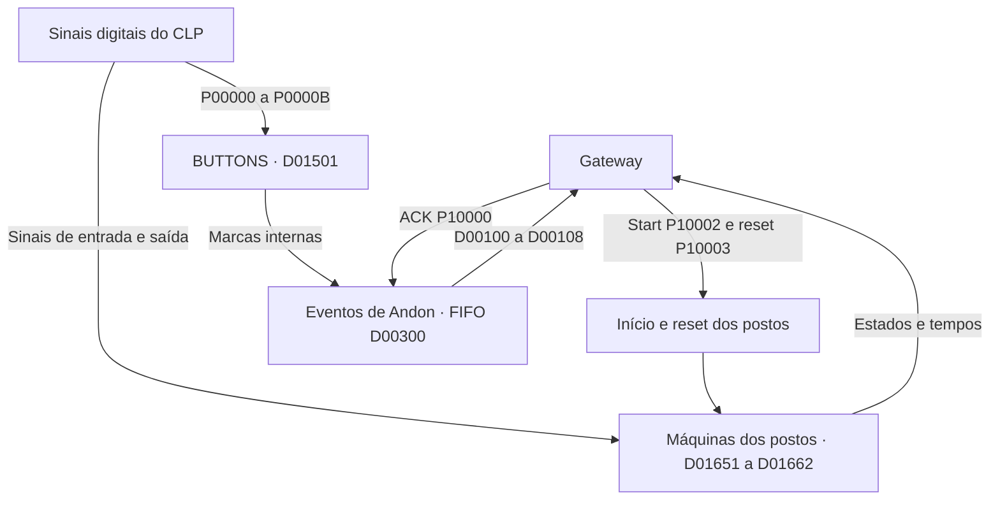
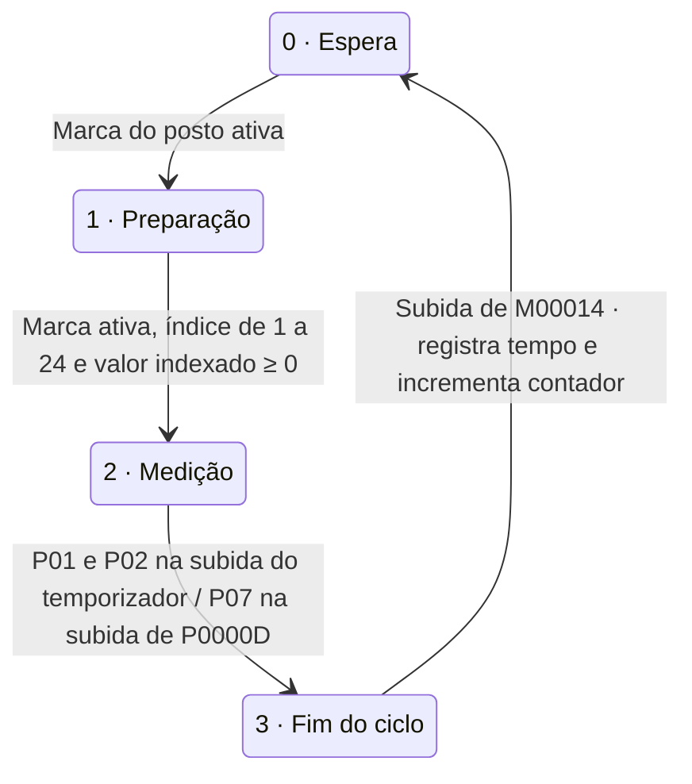
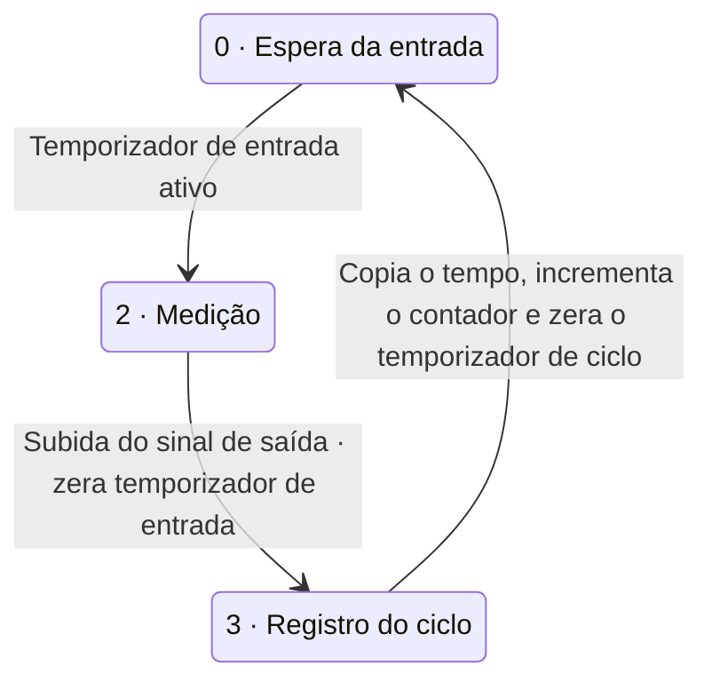
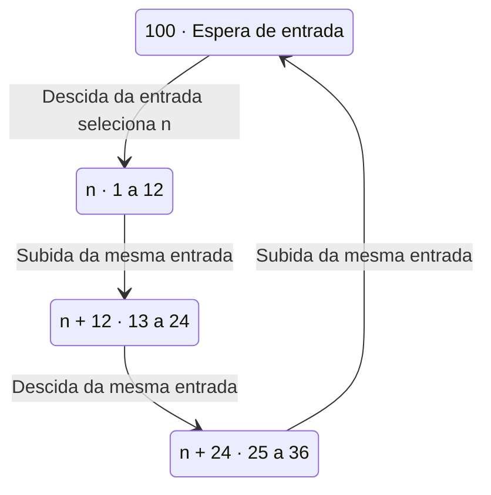
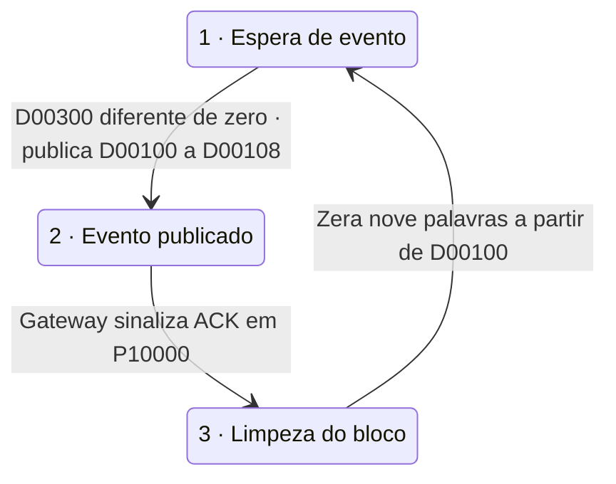

# Fluxograma e máquinas de estados do CLP

LS XGK-CPUE · Projeto `LAB_NEW_UPDATED` · XG5000

O Ladder usa registradores distintos para os estados dos postos, das entradas de botões e da publicação de eventos. Os diagramas mostram o valor desses registradores e a condição que provoca cada mudança. O fluxograma geral representa a relação entre os sinais durante a operação.

## Fluxograma geral

- **Start.** A borda de subida de `P10002` ativa `M00101`, marca de entrada do P01.
- **Reset.** A borda de subida de `P10003` zera os estados `D01651–D01662`, os temporizadores e os contadores nas faixas mostradas. Os índices de ciclo a partir de `Z001` voltam a `1`.
- **Comando do motor.** O Ladder aciona `D00112.0` quando `D01501 = 100` e pelo menos um dos postos P08, P09 e P10 está em estado diferente de `0`.

**Convenção.** No Ladder, `(P)` é a borda de subida `0 → 1` e `(N)` é a borda de descida `1 → 0`. `D` identifica palavras de dados, `M` marcas internas, `T` temporizadores, `P` dispositivos de entrada ou saída e `Z` índices.

[Postos 01, 02 e 07](#postos-01-02-e-07) · [Postos 08 a 10](#postos-08-a-10) · [Botões](#botões-em-d01501) · [Fila Andon](#fila-de-andon-em-d00050)

<!-- page -->

## Postos 01, 02 e 07

`D01651`, `D01652` e `D01657` guardam os estados de P01, P02 e P07, respectivamente. O P07 usa a mesma sequência de valores, com um sinal de campo para encerrar a medição.

| Posto | Marca de entrada | Valor consultado no estado `1` | Passagem `2 → 3` | Registro na passagem `3 → 0` |
|---|---|---|---|---|
| P01 | `M00101` | `D17001[Z001]` | Subida de `T0001`. | Copia `T0001` em `D00115`, incrementa `D16041` e seta `M00102`. |
| P02 | `M00102` | `D17025[Z002]` | Subida de `T0002`. | Copia `T0002` em `D00119`, incrementa `D16042` e seta `M00103`. |
| P07 | `M00107` | `D17145[Z007]` | Subida de `P0000D`. | Copia `T0007` em `D00139` e incrementa `D16047`. |

No estado `2`, `M00015 = 0` habilita o temporizador. P01 e P02 usam o valor indexado como preset e P07 usa `65535`. No estado `3`, `INCP` incrementa o índice do posto. Na subida de `M00014`, o Ladder copia e zera o temporizador ao concluir a sequência.

P02 e P07 desativam suas marcas de entrada no estado `2`. P01 desativa `M00101` quando `Z001` passa de `24`.

`M00014` é a combinação em série de `M00010–M00013`. Cada uma dessas quatro marcas indica que os postos do seu grupo estão em `0` ou `3`. Os grupos vistos na captura são P01–P03, P04–P06, P07 e P11–P12.

<!-- page -->

## Postos 08 a 10

Os três postos automáticos passam de `0` diretamente para `2` quando o temporizador de entrada fica ativo. O Ladder avalia a subida de um segundo sinal para encerrar a medição.

| Posto e estado | Entrada e temporizador de entrada | Saída para `2 → 3` | Temporizador de ciclo | Tempo copiado e contador |
|---|---|---|---|---|
| P08 · `D01658` | `P0000D` e `T0020` | Subida de `P0000C` | `T0008` | `D00143` e `D16048` |
| P09 · `D01659` | `P0000C` e `T0021` | Subida de `P0000F` | `T0009` | `D00147` e `D16049` |
| P10 · `D01660` | `P0000F` e `T0022` | Subida de `P0000E` | `T0010` | `D00151` e `D16050` |

Os temporizadores de entrada usam o preset `10` nas capturas. Durante o estado `2`, `M00015 = 0` habilita a medição com preset `65535`. Os valores de preset são os exibidos no Ladder.

**Passagem ao P11.** Ao registrar o ciclo, P10 ativa `M0011B`. No trecho do P11, essa marca inicia `D01661 = 1` a partir de `0`. Com a marca ativa, índice `Z011` entre 1 e 24 e `D17241[Z011] ≥ 0`, o P11 entra em `2` e copia o valor indexado para `D16004`.

<!-- page -->

## Botões em D01501

O programa `BUTTONS` usa um único registrador para a sequência das 12 entradas. `n` é a posição da entrada, de 1 para `P00000` a 12 para `P0000B`. A borda de subida de `T0000` inicializa `D01501` em `100`.

### Exemplo de leitura para P00000

| Valor de `D01501` | Sinal que produz a transição | Situação de `M00020` no estado de destino |
|---|---|---|
| `100 → 1` | Primeira descida de `P00000` | Ativa |
| `1 → 13` | Subida de `P00000` | Ativa |
| `13 → 25` | Segunda descida de `P00000` | Ativa |
| `25 → 100` | Subida de `P00000` | Inativa |

O programa `ANDON` usa as bordas da marca interna para gerar eventos. No exemplo de `M00020`, a rede do Andon amarelo define posto `1`, botão `1` e estado `1` quando ativo ou `2` quando inativo, antes de chamar `MENSAGEM_ANDON`.

<!-- page -->

## Fila de Andon em D00050

`D00050` controla a entrega do próximo evento ao Gateway. A sub-rotina `MENSAGEM_ANDON` grava oito palavras por evento na FIFO `D00300`, com tipo, posto, data/hora, botão e estado.

1. Em `1`, se `D00300 ≠ 0`, a rede reseta `P10000`, copia o cabeçalho da FIFO para `D00100` e usa `FIFRDP` para transferir as oito palavras para `D00101–D00108`.
2. Em `2`, o CLP mantém o evento disponível. O Gateway lê o bloco por Modbus, grava o evento em sua fila local e sinaliza `P10000`.
3. Em `3`, o Ladder zera `D00100–D00108` com `FMOVP` e retorna `D00050` a `1`. A rede de ajuste do relógio também escreve `1` em `D00050` após a aplicação por `P10001`, no trecho capturado.

**Trechos disponíveis.** As capturas mostram as sequências completas dos postos P01, P02 e P07–P10 e o início do P11. Para P03–P06 e P12, elas mostram referências nos sinais de grupo e no mapa de estados. As redes completas desses postos exigem a leitura do projeto Ladder.

### Referências

[Capturas do XG5000 e mapa do CLP](../Documentacao_Tecnica/DOCUMENTACAO_CLP_LS_XGK.md#capturas-do-xg5000) · [Arquitetura de comunicação](../Arquiteturas/ARQUITETURA_COMUNICACAO_LINHA.md) · [Leitura e ACK no Gateway](../../hardware/gateway/plc_poller.py)
